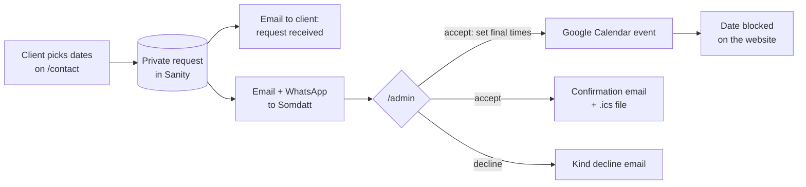

# Somdatt Sharma — Photography & Film, Hamburg

Portfolio, booking system and studio back-office for **Somdatt Sharma**, a photographer and filmmaker based in Hamburg.
One Next.js app runs three things: the public website, a content studio for editing it, and a private booking desk that installs on a phone like an app.

**Live:** [somdattsharma.com](https://www.somdattsharma.com)

---

## What it does

### 🌐 Public website — English & German
- **Home**: full-bleed hero, a recent-work spotlight, service cards with prices, a short About block with counters, a scrolling list of clients and reviews.
- **Work** (`/portfolio`): categories (Weddings, Events, Commercial…), project cards, and per-project pages with a justified gallery, a lightbox, videos and reels, a short story and quick facts.
- **Services**: each service with what's included, what you get, delivery time and a starting price. Also bundles, booking steps, an FAQ and the VAT note required in Germany.
- **About**: story, portrait, numbers, clients, a behind-the-lens gallery and the working process.
- **Contact** (`/contact`): the booking form (see below).
- **Reviews** (`/review`): clients leave a review. Reviews sent through a personal link are marked *Verified client*, and every review is approved before it appears.
- **Impressum & Datenschutz**: the legal pages required for a German business site.
- Language switch (EN / DE), light & dark theme, scroll-reveal motion that switches off under *reduced motion*, phone-first layouts with 44 px tap targets, sitemap, robots.txt and Open Graph images.

### 📅 Booking requests
- Clients pick a **date or date range** (up to 7 days) on a live availability calendar, give rough times, the event type, venue and services, and send a request.
- Each request is stored as a **private document** in Sanity. It is never in the public dataset (`bookings.` id prefix).
- **Emails via Resend.** The client gets an instant *request received* email and later a *confirmed* or *declined* email. Every email text is editable in the Studio, with a live preview.
- Confirmation emails include an **`.ics` calendar file** and an "Add to Google Calendar" link.
- **Notifications:** an email to the owner, plus an optional WhatsApp ping (CallMeBot).
- **Spam protection:** honeypot field and per-IP rate limiting.

### 🗂️ Booking desk — `/admin` (installable PWA)
- **Dashboard**: new requests, upcoming shoots, booked days and reviews waiting for approval, plus "next up" with a countdown and a route link.
- **Requests**: sort by newest, waiting longest or event date; search; an automatic *fits / tight travel time / overlaps* check against confirmed jobs.
- **Accept**: set the final schedule as *one block*, *same hours daily* or *per day*. Car travel times to the jobs before and after come from OpenRouteService. Pick an email template, preview it, then accept.
- **Decline** with ready-made templates, e.g. *already booked* (with a "see free dates" button), *too far* or *not the right fit*.
- **Calendar**: month, week (time grid) and list views, with filters.
- **Booking page**: one-tap call / WhatsApp / email / route, private notes with a timeline, automatic history, custom emails (deposit reminder, gallery ready), cancel / restore / delete.
- **Manual bookings** for jobs agreed by phone, with a clash warning.
- **Google Calendar sync** (write-only): accepted jobs are added to the owner's calendar, and personal events are never read.
- **Reviews**: personal review links and QR codes, plus approve / reject.
- **Guide**: a built-in, illustrated handbook for the booking desk and the Studio.

### ✍️ Content studio — `/studio`
- Sanity Studio embedded in the app, with a sidebar that mirrors the site: Home · Work · Services · About · Reviews · Site settings · Bookings.
- **Live preview** of the page next to the form (desktop and phone).
- **EN → DE auto-translation** of every text field through the Vercel AI Gateway. German edited by hand is kept until the English changes.
- **Booking settings**: the contact form (event types, services, extra questions) and all email templates, each with a live email preview.
- Drafts → **Publish**, with full version history.

---

## How a booking flows



---

## Tech stack

| | |
|---|---|
| Framework | [Next.js 16](https://nextjs.org) (App Router, Server Actions, Turbopack) · React 19 · TypeScript |
| Styling & motion | Tailwind CSS 4 · Framer Motion · Lenis smooth scroll · self-hosted variable fonts |
| Content | [Sanity](https://www.sanity.io) (Studio embedded at `/studio`, `next-sanity`, visual editing / draft mode) |
| Auth | Auth.js (NextAuth v5): password login for the booking desk |
| Email | [Resend](https://resend.com) |
| Integrations | Google Calendar API (service account) · [OpenRouteService](https://openrouteservice.org) · CallMeBot (WhatsApp) |
| AI | [AI SDK](https://ai-sdk.dev) via Vercel AI Gateway (Studio translations) |
| Hosting | [Vercel](https://vercel.com) |

---

## Project structure

```
src/
├── app/
│   ├── page.tsx              Home
│   ├── portfolio/            Work overview (categories)
│   ├── projects/[slug]/      Project pages
│   ├── services/ about/ contact/ review/
│   ├── impressum/ datenschutz/
│   ├── admin/                Booking desk (dashboard, requests, calendar, bookings, reviews, guide)
│   ├── studio/               Embedded Sanity Studio
│   ├── api/                  auth, booking .ics, draft mode, translate
│   └── fonts/                Self-hosted woff2 files
├── components/               UI by area: admin, booking, work, sections, about, services, reviews, layout
├── lib/                      Bookings, time model, emails, mailer, Google Calendar, travel times, reviews
├── sanity/                   Schemas, desk structure, queries, Studio components (preview, translation, email preview)
└── i18n/                     EN / DE strings
public/
├── admin-guide/              Screenshots used in the guide
└── admin-icons/              PWA icons
```

---

## Getting started

```bash
npm install
cp .env.example .env.local   # fill in the values — never commit this file
npm run dev
```

| URL | What |
|---|---|
| http://localhost:3000 | Website |
| http://localhost:3000/studio | Content studio (Sanity login) |
| http://localhost:3000/admin | Booking desk (`ADMIN_PASSWORD`) |

Other scripts: `npm run build` · `npm run start` · `npm run lint`

### Environment variables

Every key is listed and explained in [`.env.example`](.env.example). In short:

| Group | Keys |
|---|---|
| Sanity | `NEXT_PUBLIC_SANITY_PROJECT_ID`, `NEXT_PUBLIC_SANITY_DATASET`, `NEXT_PUBLIC_SANITY_API_VERSION`, `SANITY_WRITE_TOKEN` |
| Booking desk | `ADMIN_PASSWORD`, `AUTH_SECRET` |
| Email | `RESEND_API_KEY`, `RESEND_FROM`, `CONTACT_TO_EMAIL` (optional `BOOKING_FROM`, `SITE_URL`) |
| Google Calendar | `GOOGLE_CLIENT_EMAIL`, `GOOGLE_PRIVATE_KEY`, `GOOGLE_CALENDAR_ID` |
| Travel times | `ORS_API_KEY` |
| WhatsApp (optional) | `CALLMEBOT_API_KEY`, `CALLMEBOT_PHONE` |
| Translation (optional) | `AI_TRANSLATE_MODEL` (auth through Vercel OIDC) |

Every integration is optional: without its keys, that feature simply switches off. For example, there is no calendar sync without Google credentials.

---

## Deploy

The Vercel project is connected to this repository:

- push to **`main`** → **production** (somdattsharma.com)
- push to any other branch → **preview** deployment (private `*.vercel.app` URL)

Environment variables live in Vercel (Production + Preview), with the same keys as `.env.example`.
Content changes made in the Studio go live within about a minute and don't need a deploy.

---

## Privacy & security notes

- Booking requests are **private Sanity documents**, readable only with the server token. They are never in the public dataset or the CDN.
- Notes are **never** included in emails to clients.
- Google Calendar access is **write-only**: the site adds and removes its own events and never reads personal ones.
- Secrets live in `.env.local` / Vercel only. `.env*` files are git- and deploy-ignored.

---

## Credits

Design & development for Somdatt Sharma.
All photographs, videos and texts © Somdatt Sharma — all rights reserved; not for reuse.
Fonts: Hanken Grotesk, Bricolage Grotesque, Archivo and Fraunces (SIL Open Font License).
