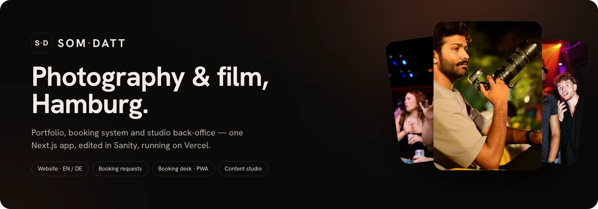
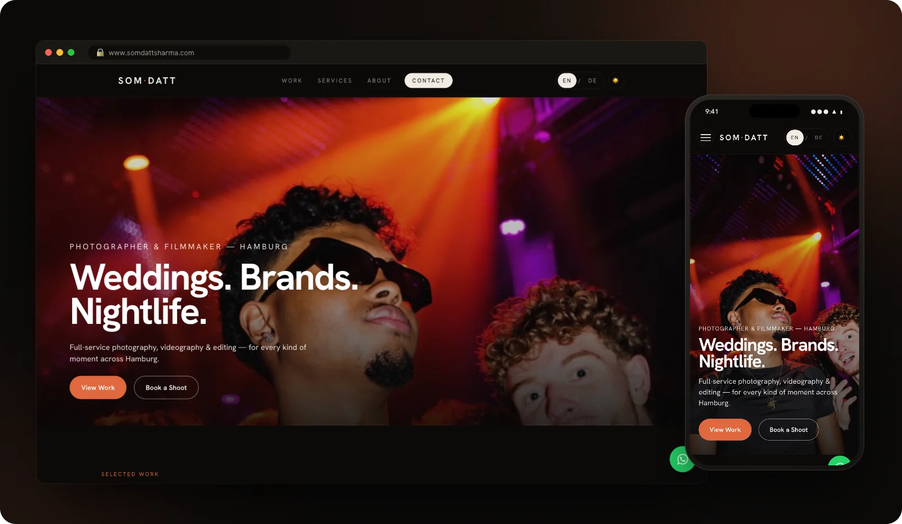
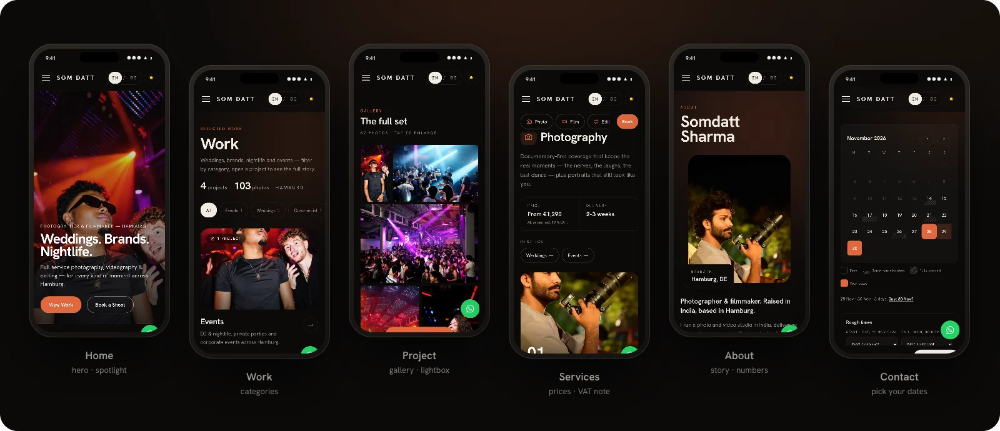
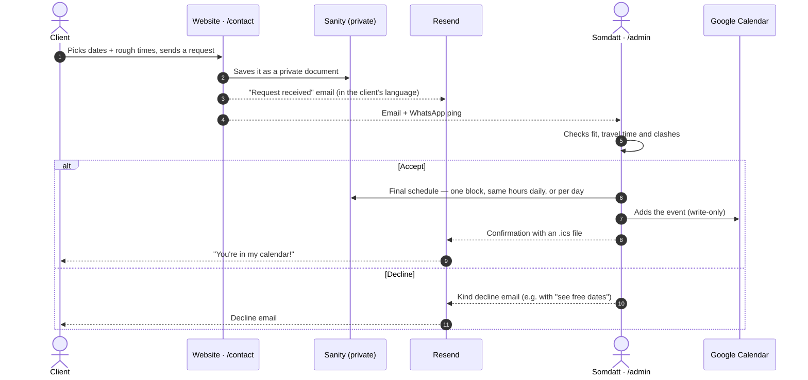
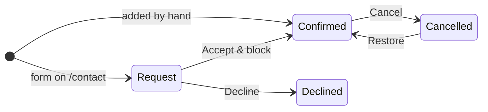
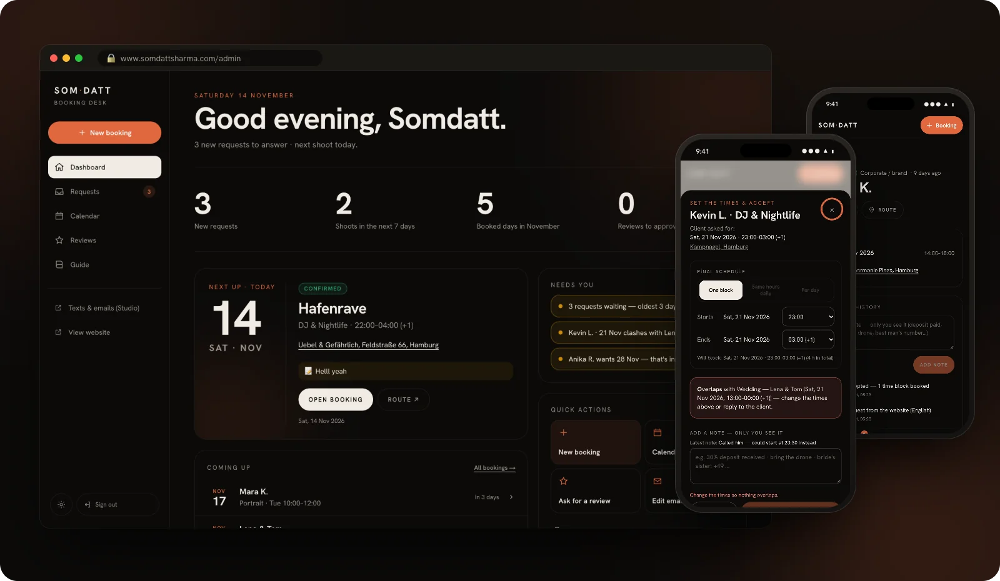
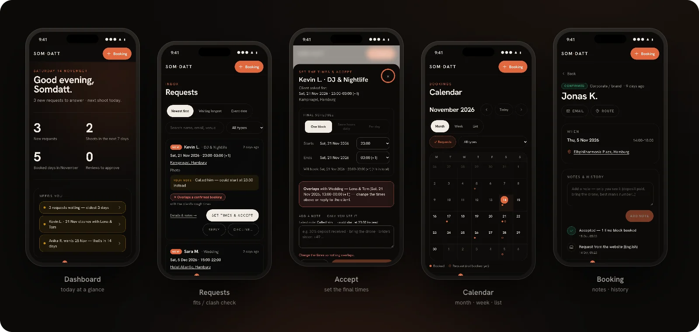
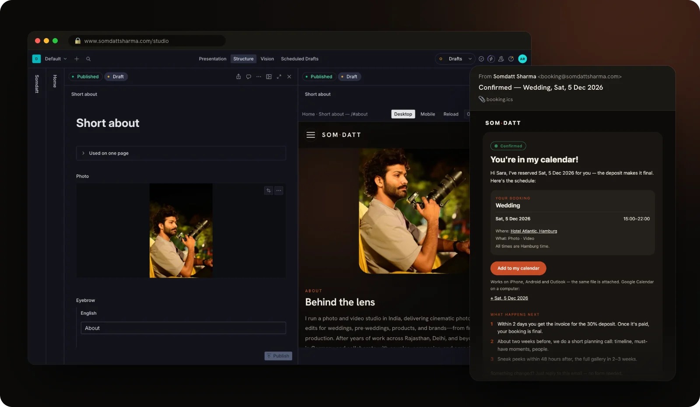
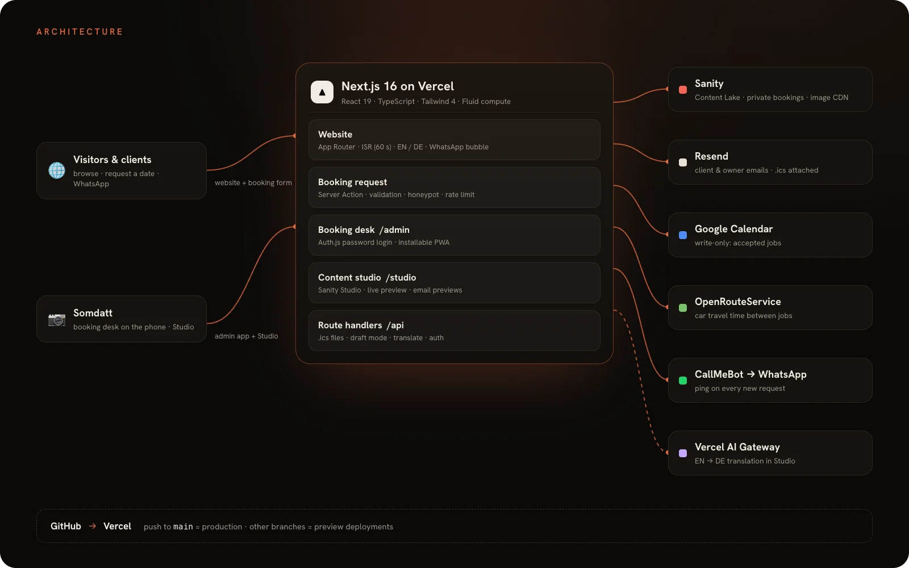
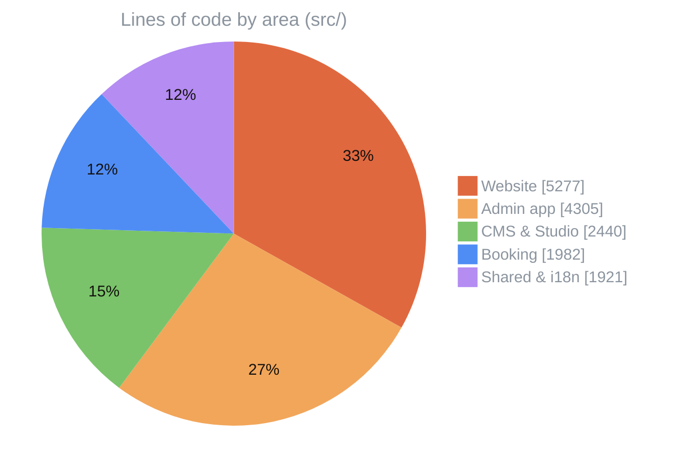

<p align="center">
  <a href="https://www.somdattsharma.com"></a>
</p>

<p align="center">
  <a href="https://www.somdattsharma.com"></a>
  
  
  
  
  
  
</p>

<p align="center">
  <a href="#website"><b>Website</b></a> ·
  <a href="#bookings"><b>Bookings</b></a> ·
  <a href="#booking-desk"><b>Booking desk</b></a> ·
  <a href="#studio"><b>Studio</b></a> ·
  <a href="#architecture"><b>Architecture</b></a> ·
  <a href="#getting-started"><b>Getting started</b></a>
</p>

<br>

**Somdatt Sharma** is a photographer and filmmaker in Hamburg. This repository is his whole studio online. It includes a bilingual portfolio, a booking system clients use to request dates, a phone-friendly back-office for answering those requests, and a content studio where every word and photo can be changed without touching code.

<p align="center">
  
</p>

## ✨ At a glance

<table>
  <tr>
    <td width="33%" valign="top">
      <h3>🌐 Portfolio</h3>
      English & German, light & dark. Work by category, project stories with galleries and films, services with prices.
    </td>
    <td width="33%" valign="top">
      <h3>📅 Booking requests</h3>
      Clients pick a date range on a live availability calendar, then get emails in their language.
    </td>
    <td width="33%" valign="top">
      <h3>📱 Booking desk</h3>
      An installable app with a dashboard, requests, calendar, notes and history. Accept, decline or add bookings in a few taps.
    </td>
  </tr>
  <tr>
    <td width="33%" valign="top">
      <h3>✍️ Content studio</h3>
      Sanity Studio with live page preview and EN → DE auto-translation. Draft, then publish.
    </td>
    <td width="33%" valign="top">
      <h3>🗓️ Calendar & travel</h3>
      Accepted jobs land in Google Calendar (write-only). Car travel times between jobs come from OpenRouteService.
    </td>
    <td width="33%" valign="top">
      <h3>💬 WhatsApp</h3>
      A chat bubble on every page, plus an instant WhatsApp ping to the owner for each new request.
    </td>
  </tr>
</table>

---

<a id="website"></a>

## 🌐 The website

<p align="center">
  
</p>

| Page | What's on it |
|---|---|
| **Home** | Full-bleed hero, recent-work spotlight, service cards with prices, About teaser with counters, clients, reviews |
| **Work** `/portfolio` | Categories (Weddings, Events, Commercial…), project cards, a justified gallery with lightbox, videos and reels |
| **Services** | What's included, delivery time, starting price, bundles, booking steps, FAQ, the German VAT note |
| **About** | Story, portrait, numbers, clients, behind-the-lens gallery, working process |
| **Contact** | The booking form: date range, rough times, event type, venue, services |
| **Reviews** `/review` | Clients write a review. Reviews from personal links are marked *Verified client*, and every review is approved first |

Also on the website: scroll-reveal motion that switches off under *reduced motion*, 44 px tap targets, no sideways scrolling on phones, self-hosted fonts, sitemap, robots.txt and Open Graph images.

---

<a id="bookings"></a>

## 📅 How a booking works



**Booking status**



- **Language:** emails go out in the language the client used on the site (EN / DE).
- **Days:** a booking day runs 06:00 → 06:00, so night jobs stay on one date. A request can cover up to 7 days.
- **Privacy:** requests are private Sanity documents, and notes are never emailed.
- **Spam:** the form has a honeypot field and a per-IP rate limit.

---

<a id="booking-desk"></a>

## 🗂️ The booking desk · `/admin`

<p align="center">
  
</p>

<p align="center">
  
</p>

- **Installable app (PWA):** an S·D icon on the home screen that opens full screen and stays signed in.
- **Dashboard:** new requests, the next shoot with a countdown and route link, and what needs attention.
- **Requests:** sort, search, and an automatic *fits / tight travel time / overlaps* check against confirmed jobs.
- **Accept:** set the final times as a single block, the same hours daily, or different times per day. Choose an email template, preview it, then confirm.
- **Calendar:** month, week time-grid and list views, with filters.
- **Booking page:** call, WhatsApp, email and route in one tap; private notes with a timeline; automatic history; ready-made emails (deposit reminder, gallery ready).
- **Reviews:** personal review links and QR codes, plus approve or reject.
- **Built-in guide:** an illustrated handbook for the booking desk and the Studio.

---

<a id="studio"></a>

## ✍️ Content studio & emails

<p align="center">
  
</p>

- **Sanity Studio** is embedded at `/studio`, with a sidebar that mirrors the site: Home · Work · Services · About · Reviews · Site settings · Bookings.
- **Live preview** of the page sits next to the form, on desktop and phone.
- **EN → DE auto-translation** works on every field. German edited by hand is kept until the English changes.
- **Booking settings** hold the form (event types, services, extra questions) and every email template, each with a live email preview.
- **Emails** are table-based, work in dark mode, go out from `booking@` with replies going to the owner's inbox, and come with an `.ics` file for any calendar app.

---

<a id="architecture"></a>

## 🏗️ Architecture

<p align="center">
  
</p>

| Service | Role | Without it |
|---|---|---|
| **Sanity** | Content, private bookings, image CDN, Studio | required |
| **Resend** | Client and owner emails | no emails are sent |
| **Google Calendar** | Accepted jobs are added to the owner's calendar | no calendar sync |
| **OpenRouteService** | Car travel time between jobs | the travel check shows "unknown" |
| **CallMeBot** | WhatsApp ping on new requests | email notification only |
| **Vercel AI Gateway** | Studio translation EN → DE | German is typed by hand |

Content changes go live within about a minute (ISR, 60 s) without a deploy.

### 📊 Codebase



<sub>125 TypeScript / CSS files · about 16k lines</sub>

---

## 🧰 Tech stack

| | |
|---|---|
| **Framework** | Next.js 16 (App Router, Server Actions, Turbopack) · React 19 · TypeScript |
| **Styling & motion** | Tailwind CSS 4 · Framer Motion · Lenis · self-hosted variable fonts |
| **Content** | Sanity (embedded Studio, `next-sanity`, draft mode / visual editing) |
| **Auth** | Auth.js (NextAuth v5): password login for the booking desk |
| **Email** | Resend |
| **Integrations** | Google Calendar API (service account) · OpenRouteService · CallMeBot |
| **AI** | AI SDK via Vercel AI Gateway |
| **Hosting** | Vercel, connected to this repo |

---

<a id="getting-started"></a>

## 🚀 Getting started

```bash
npm install
cp .env.example .env.local   # fill in the values — never commit this file
npm run dev
```

| URL | What |
|---|---|
| `http://localhost:3000` | Website |
| `http://localhost:3000/studio` | Content studio (Sanity login) |
| `http://localhost:3000/admin` | Booking desk (`ADMIN_PASSWORD`) |

<details>
<summary><b>Environment variables</b></summary>
<br>

Every key is explained in [`.env.example`](.env.example).

| Group | Keys |
|---|---|
| Sanity | `NEXT_PUBLIC_SANITY_PROJECT_ID`, `NEXT_PUBLIC_SANITY_DATASET`, `NEXT_PUBLIC_SANITY_API_VERSION`, `SANITY_WRITE_TOKEN` |
| Booking desk | `ADMIN_PASSWORD`, `AUTH_SECRET` |
| Email | `RESEND_API_KEY`, `RESEND_FROM`, `CONTACT_TO_EMAIL` (optional `BOOKING_FROM`, `SITE_URL`) |
| Google Calendar | `GOOGLE_CLIENT_EMAIL`, `GOOGLE_PRIVATE_KEY`, `GOOGLE_CALENDAR_ID` |
| Travel times | `ORS_API_KEY` |
| WhatsApp ping (optional) | `CALLMEBOT_API_KEY`, `CALLMEBOT_PHONE` |
| Translation (optional) | `AI_TRANSLATE_MODEL` (auth through Vercel OIDC) |

</details>

<details>
<summary><b>Project structure</b></summary>
<br>

```
src/
├── app/
│   ├── page.tsx              Home
│   ├── portfolio/            Work overview (categories)
│   ├── projects/[slug]/      Project pages
│   ├── services/ about/ contact/ review/
│   ├── impressum/ datenschutz/
│   ├── admin/                Booking desk (dashboard, requests, calendar, bookings, reviews, guide)
│   ├── studio/               Embedded Sanity Studio
│   ├── api/                  auth, booking .ics, draft mode, translate
│   └── fonts/                Self-hosted woff2 files
├── components/               UI by area: admin, booking, work, sections, about, services, reviews, layout
├── lib/                      Bookings, time model, emails, mailer, Google Calendar, travel times, reviews
├── sanity/                   Schemas, desk structure, queries, Studio components
└── i18n/                     EN / DE strings
public/
├── admin-guide/              Screenshots used in the in-app guide
└── admin-icons/              PWA icons
docs/readme/                  Images in this README
```

</details>

<details>
<summary><b>Scripts</b></summary>
<br>

| Command | |
|---|---|
| `npm run dev` | Local development |
| `npm run build` | Production build |
| `npm run start` | Serve the production build |
| `npm run lint` | ESLint |

</details>

---

## 🚢 Deploy

The Vercel project is connected to this repository:

| Push to | Result |
|---|---|
| **`main`** | **Production** — [somdattsharma.com](https://www.somdattsharma.com) |
| any other branch | **Preview deployment** (private `*.vercel.app` URL) |

Environment variables live in Vercel (Production + Preview), with the same keys as `.env.example`.

---

## 🔐 Privacy & security

- Booking requests are **private Sanity documents**, readable only with the server token. They are never in the public dataset or on the CDN.
- Notes are **never** included in emails to clients.
- Google Calendar access is **write-only**: the site adds and removes its own events and never reads personal ones.
- The WhatsApp bubble is a plain link. No WhatsApp script is loaded on the site.
- Secrets live in `.env.local` and Vercel only. `.env*` files are git- and deploy-ignored.

---

<p align="center">
  <br>
  <sub>Design & development for <b>Somdatt Sharma</b> · Hamburg</sub><br>
  <sub>All photographs, videos and texts © Somdatt Sharma — all rights reserved, not for reuse.<br>
  Fonts: Hanken Grotesk, Bricolage Grotesque, Archivo, Fraunces (SIL Open Font License).</sub>
</p>
